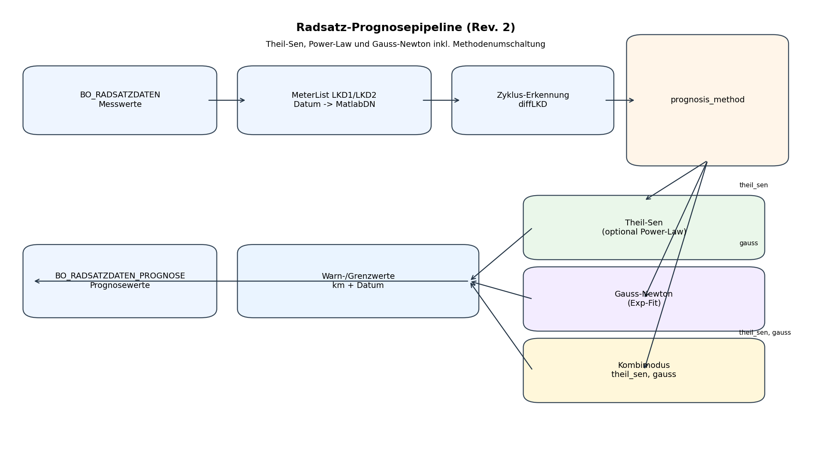
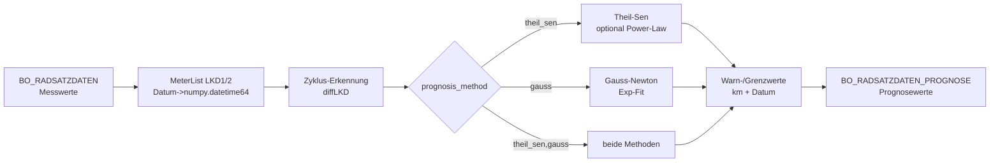

# Technische Doku (kurz)

## Programme im Projekt

| Skript | Prognosemethode | Detaildoku |
|--------|-----------------|------------|
| `Radsatz_Bahn_DB_new_Approach.py` | Methodenumschaltbar per INI: `theil_sen`, `gauss`, oder `theil_sen, gauss` (Kombiplot); Theil-Sen optional mit Baureihen-Fallback | `doc/Programm_Doku_new_Approach.md` |
| `Radsatz_Bahn_DB_KM_Default_Class_All.py` | `VehicleAxis.CalcPrognostic()` (Gauss-Newton / Exponential, Default-Kurven-Mischung) | diese Datei, Abschnitt Datenfluss „Legacy“ |

Gemeinsam: `radsatz_config.ini`, `radsatz_settings.py`, `MeterList`, `VehicleAxis` (Ausgabe), `toolsWheelset.getStartIndexLastCycle`, Oracle/CSV-Pfade.

**Daten-Voraussetzungen:** `doc/Programm_Doku_new_Approach.md`, Abschnitt **2.4–2.7**.  
**Aufgabe (Prognose, Reprofilierungs-Intervall/-Abtrag):** dort Abschnitt **1.1–1.3**.

## Datenfluss (gemeinsame Basis)

- Quelle: Oracle-DB `BO_RADSATZDATEN` (historische Messwerte) und optional Ziel `BO_RADSATZDATEN_PROGNOSE`.
- Abfrage: alle aktuell eingebauten Achsen (Fahrzeug/Drehgestell/Achse) und Messwerte fuer LKD1/LKD2 ab `dtStartData`.
- Aufbereitung: Messreihen in zwei `MeterList`-Objekten (LKD1/LKD2); Datum wird als `numpy.datetime64[s]`-Array gespeichert (Helper: `dates_np.to_datetime64_array`). Im Legacy-Pfad (`Radsatz_Bahn_DB_KM_Default_Class_All.py`) gilt weiter die alte Matlab-Datezahl-Konvertierung.
- Zyklus-Erkennung: `getStartIndexLastCycle()` identifiziert den Start des letzten Verschleisszyklus via Sprungkriterium `diffLKD`.
- Output: Prognosewerte (km/Datum) und Warn-/Grenzwerte werden optional in `BO_RADSATZDATEN_PROGNOSE` geschrieben; alte Prognosen werden vorab geloescht (`nDays2Delete`).

### Prognoseberechnung (Legacy)

- `VehicleAxis.CalcPrognostic()` entfernt Reprofilierungs-Spruenge, fitet Exponentialkurve (Gauss-Newton) und erzeugt Prognosewerte bis `nKm` (nur im Skript `Radsatz_Bahn_DB_KM_Default_Class_All.py`).

### Prognoseberechnung (neuer Ansatz)

- Modulfunktionen in `Radsatz_Bahn_DB_new_Approach.py` (Theil–Sen, Gauss, Mehrmethoden-Orchestrierung, robuste Tage/km).
- Kombimodus: Historie einmal, Prognosekurven beider Methoden im selben Diagramm.
- Bei Teilfehlern pro Achse wird mit der verbleibenden Methode weitergearbeitet.

#### Methoden kurz erklärt (wann im Einsatz)

| Methode | Typ | Wann verwendet |
|---------|-----|----------------|
| Theil-Sen | robust linear | Bei `prognosis_method = theil_sen` (oder im Kombimodus) als Standardverfahren |
| Power-Law | nichtlinear | Innerhalb des Theil-Sen-Zweigs, wenn linearer RMSE oberhalb Schwelle liegt und genug Punkte vorhanden sind |
| Gauss-Newton | nichtlinear (exponentiell) | Bei `prognosis_method = gauss` (oder im Kombimodus) über `VehicleAxis.CalcPrognostic()` |

Ausführliche Erläuterungen (Grundform, Stärken/Schwächen, Parameterschätzung): `doc/Programm_Doku_new_Approach.md`, Abschnitt **7.0b–7.0d** (Power-Law, Theil-Sen, Gauss-Newton).

## Zentrale Parameter (`radsatz_config.ini`)

- `dt_start_data`, `n_km`, `diff_lkd`, `n_days_2_delete`: von beiden Hauptskripten genutzt.
- `prognosis_method`: `theil_sen`, `gauss`, oder `theil_sen, gauss`.
- `def_jump_repro`, `def_param_exp_a0/a1`, `n_km_repro`, `n_value_repro`: im Gauss-Zweig des neuen Hauptskripts aktiv genutzt.
- `[prognose_new] baureihe_fallback`: optionaler Theil-Sen-Fallback bei unzureichender Datenlage.

### Typische INI-Beispiele

```ini
[prognose]
prognosis_method = theil_sen
```

```ini
[prognose]
prognosis_method = gauss
```

```ini
[prognose]
prognosis_method = theil_sen, gauss
```

### Setup nach Einsatzzweck

| Zweck | Einstellung |
|---|---|
| Standardbetrieb | `prognosis_method = theil_sen` |
| Methodenvergleich in einem Diagramm | `prognosis_method = theil_sen, gauss` |
| Nur Gauss-Lauf | `prognosis_method = gauss` |
| Optionaler Theil-Sen-Fallback bei `INSUFFICIENT` | `[prognose_new] baureihe_fallback = true` |
| Fokus auf eine Einheit | `[plot] plot_top_einheit_filter = FLIRT 101` |

## DB-Schema (aus Code ersichtlich)
### `BO_RADSATZDATEN` (Quelle)
- Identifikation: `TOPEINHEITBEZEICHNUNG`, `DGEINBAUPOS`, `RSEINBAUPOS`
- Messart: `ZARTBEZ`, `ZAEHLERARTID`
- Messung: `DATUM`, `STAND`, `LAUFLEISTUNG`
- Grenzwerte: `MIN`, `MAX`, `GELB_MIN`
- Metadaten: `TOPEINHEITID`, `DGEINHEITID`, `DGBEZEICHNUNG`, `RSEINHEITID`, `RSBEZEICHNUNG`, `EINBAU`, `AUSBAU`, `AKTUELL`

### `BO_RADSATZDATEN_PROGNOSE` (Ziel)
- Identifikation: wie Quelle
- Messart: `ZAEHLERARTID`, `ZARTBEZ`
- Prognosepunkt: `STAND`, `DATUM`, `LAUFLEISTUNG`
- Aenderung: `LETZTEAENDZEIT`
- Grenz-/Warnwerte: `KM_GRENZWERT`, `DATUM_GRENZWERT`, `KM_WARNWERT`, `DATUM_WARNWERT`

## Schema-Skizze (kurzes Diagramm)

Die **sichtbare Grafik** ist die PNG-Datei `radsatz_prognose_datenfluss.png` im **gleichen Ordner** wie diese Datei. Sie wird per Standard-Markdown und zusätzlich per HTML eingebunden (manche Viewer zeigen nur eine der beiden Varianten).

- **Markdown:** `` — funktioniert nur, wenn der Viewer Bilder unterstützt und den Pfad relativ zur `.md`-Datei auflöst.
- **HTML (Fallback):** `` — gleiche Voraussetzung; einige Vorschauen rendern HTML in Markdown, andere nicht.
- **Mermaid-Block** darunter: wird nur angezeigt, wenn der Viewer **Mermaid** unterstützt (z. B. GitHub, manche IDE-Erweiterungen). Ohne Mermaid-Unterstützung sehen Sie nur den Quellcode-Block, **kein** Diagramm.

Wenn Sie **gar kein** Bild sehen: Viewer hat oft **keine Bildvorschau** für lokale Dateien, oder die `.md` wird aus einem anderen Arbeitsverzeichnis geöffnet — dann die PNG direkt doppelklicken oder in Cursor/VS Code „Markdown Preview“ nutzen.





