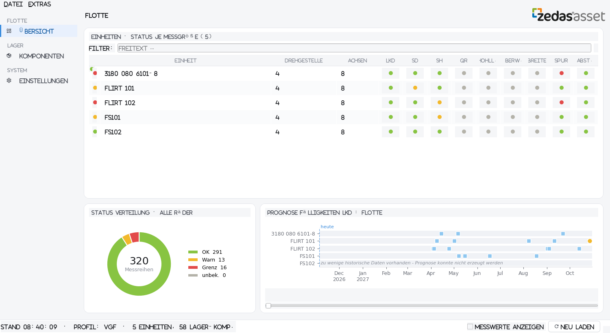
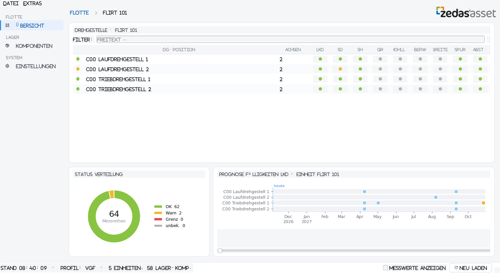
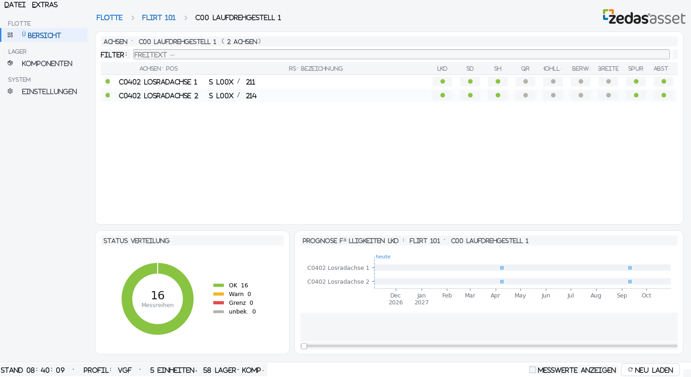
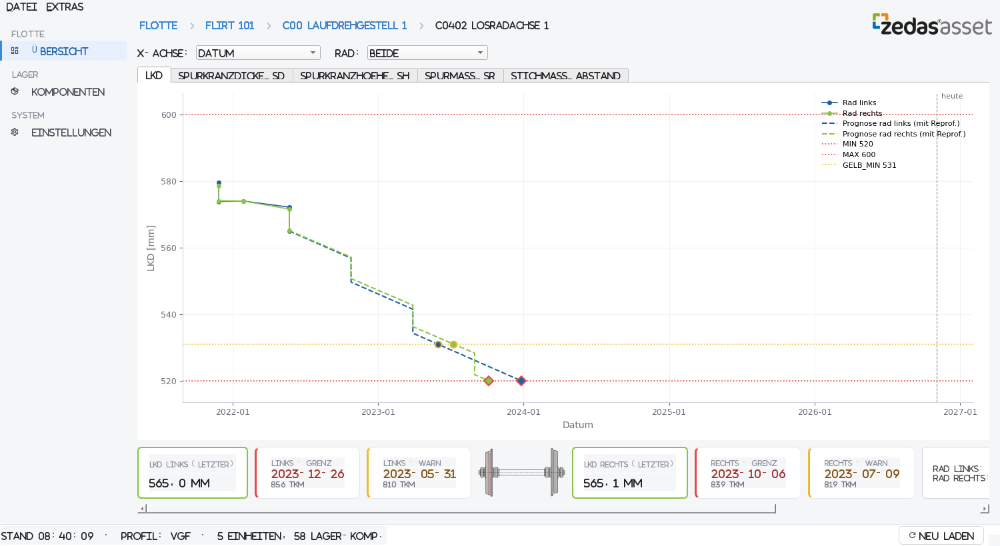
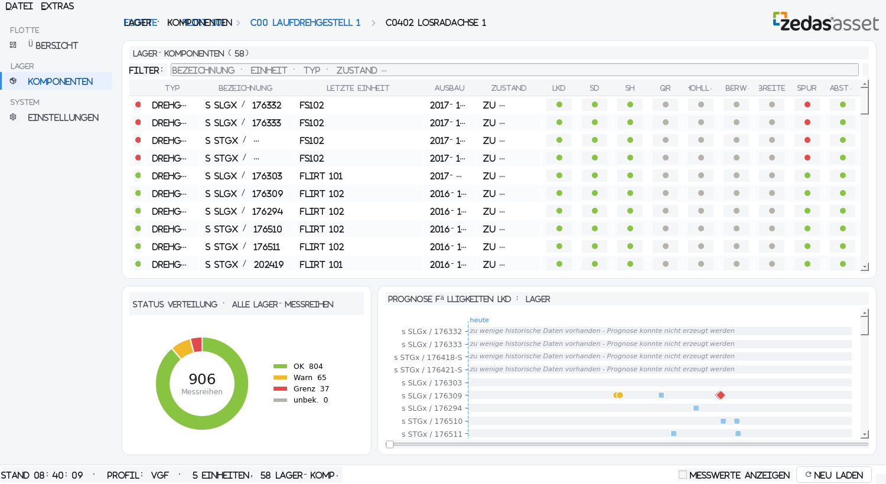
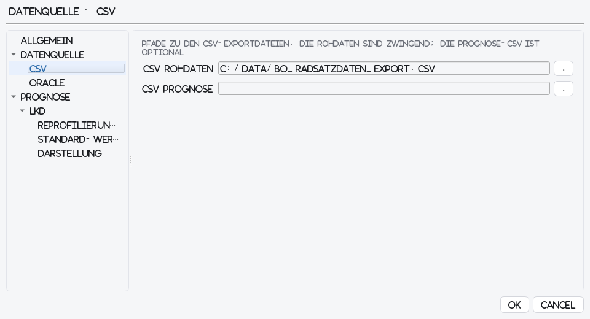

# Wheelset Analyzer Dashboard — Anwenderhandbuch

## Einleitung

Das Wheelset Analyzer Dashboard zeigt den Zustand der Radsätze eines
Schienenfahrzeugbestands auf einen Blick, wann die nächste Reprofilierung ansteht und wann Warn- bzw.
Grenzwerte voraussichtlich unterschritten werden. Das Programm liest
Rohdaten aus einer Oracle-Datenbank sowie bei Bedarf auch aus CSV-Dateien und
ergänzt sie mit einer prognostizierten Fortsetzung der Verschleiß-
kurven bis zum nächsten Unterschreiten der Limits.

Die Oberfläche ist als Drilldown aufgebaut: *Flotte → Einheit →
Drehgestell → Achse*. Für ausgebaute Räder und Drehgestelle gibt es
zusätzlich den Bereich *Lager · Komponenten*. Überall gilt:

- **Grüne Statuskreise** bedeuten „im Rahmen", **gelbe** „Warnschwelle
  bereits unterschritten", **rote** „Grenzwert bereits unterschritten".
- In den Fälligkeiten-Kacheln stehen **hellblaue Quadrate** für
  geplante Reprofilierungen, **orangene Kreise** für prognostizierte
  Warnunterschreitungen und **rote Rauten** für prognostizierte
  Grenzwertunterschreitungen — wer sich an den orangenen orientiert,
  verhindert die roten.
- **Sortieren oder Filtern** in der Tabelle ordnet und beschränkt
  auch die zugehörige Fälligkeiten-Kachel direkt mit — der visuelle
  Zusammenhang bleibt erhalten.
- Hover über einen Marker zeigt Datum und zugehöriges Rad als
  Tooltip; der horizontale Schieberegler unter der Kachel verschiebt
  die Zeitachse weiter in die Zukunft.

## Flotten-Übersicht

Die Startansicht nach dem Programmstart.

Was zu sehen ist:
- **Tabelle *Einheiten: Anzahl N - Status (anhand schlechtesten,
  letzten Messwert)*:** eine Zeile pro Einheit, pro Messgröße ein
  Statuskreis. Die Ampel pro Zelle entspricht dem schlechtesten Rad-
  Status dieser Messgröße, bezogen auf den jeweils letzten Messwert.
  *N* ist die tatsächliche Zeilenanzahl in der Tabelle (folgt dem
  Filter).
- **Donut *Status Verteilung · alle Räder*:** Mengenverteilung der
  Räder über die Flotte.
- **Kachel *Prognose Fälligkeiten LKD : Flotte*:** waagerechter
  Zeitstrahl mit anstehenden Reprofilierungen, Warn- und
  Grenzüberschreitungen je Einheit.

Was man machen kann:
- **Doppelklick auf eine Einheit** → öffnet die Einheitsübersicht.
- **Filter** schränkt die Einheiten ein, die Kachel folgt.
- **Hover** auf einen Marker in der Kachel: Tooltip mit Datum und
  Rad.
- Scrollbalken rechts in der Kachel erscheint automatisch, wenn
  mehr Zeilen da sind als sichtbar.

Zeilen mit dem Text *„keine historischen Daten vorhanden"* bzw. *„zu
wenige historische Daten vorhanden"* bedeuten: für diese Einheit lässt
sich keine Prognose erzeugen.

## Einheitsübersicht

Nach Doppelklick auf eine Einheit.

Was zu sehen ist:
- **Tabelle *Drehgestelle*:** eine Zeile pro Drehgestell, mit
  Statuskreis je Messgröße.
- **Donut** und **Fälligkeiten-Kachel** analog zur Flotten-Übersicht,
  aber bezogen auf diese Einheit.

Was man machen kann:
- **Doppelklick auf ein Drehgestell** → öffnet die Drehgestell-Ansicht.
- Zurück zur Flotte über den Breadcrumb *Flotte* oder die Sidenav.

## Drehgestell-Ansicht

Nach Doppelklick auf ein Drehgestell.

Was zu sehen ist:
- **Tabelle *Achsen*:** eine Zeile pro Achse des Drehgestells.
- **Donut** und **Fälligkeiten-Kachel** bezogen auf dieses Drehgestell.

Was man machen kann:
- **Doppelklick auf eine Achse** → öffnet das Prognose-Diagramm.
- Zurück über Breadcrumb oder Sidenav.

## Prognose-Diagramm (Achsen-Detail)

Das Herz der Anwendung: Verlauf und Prognose einer einzelnen Achse.

Was zu sehen ist:
- **Steuerleiste oben:**
  - *X-Achse:* Datum oder Laufleistung in km.
  - *Rad:* Beide / nur links / nur rechts.
- **Reiter** oben: einer pro Messgröße (LKD, Spurkranzhöhe,
  Spurkranzdicke, …). Standardmäßig ist LKD vorn.
- **Diagramm:** Historie-Punkte je Rad, prognostizierte Fortsetzung
  als gestrichelte Treppe bis zum Minimum, waagerechte Linien für
  MIN (rot), GELB_MIN (orange) und MAX / GELB_MAX falls vorhanden,
  Marker an den Schnittpunkten (Datum + Laufleistung).
- **Kennzahlen-Zeile unter dem Diagramm:**
  - Links: Kacheln für das **linke Rad** (letzter Messwert, Warn-,
    Grenzprognose).
  - Mitte: kleine **Radsatz-Grafik** als visuelle Trennung.
  - Rechts: Kacheln für das **rechte Rad**.
  - Bei schmalem Fenster erscheint ein horizontaler Scrollbalken; alle
    Kacheln bleiben über Scrollen erreichbar.

Was man machen kann:
- **X-Achse umschalten** zwischen Datum und km.
- **Rad isolieren** (nur links / nur rechts).
- **Reiter wechseln**, um dieselbe Achse für andere Messgrößen zu
  sehen.
- Zurück über Breadcrumb oder Sidenav.

## Lager · Komponenten

Übersicht über ausgebaute Achsen und Drehgestelle.

Was zu sehen ist:
- **Tabelle *Lager-Komponenten: Anzahl N - Status (anhand
  schlechtesten, letzten Messwert)*:** eine Zeile pro Komponente, mit
  Typ (Drehgestell / Achse), Bezeichnung, letzter Einbau-Einheit,
  Ausbaudatum, Zustand (einsatzbereit / zu überholen) und Statuskreisen
  je Messgröße. Bei aktivem Zustands-Filter oder Drilldown wird der
  Zusatz *· einsatzbereit* bzw. *· zu überholen* angehängt; *N* zählt
  die aktuell sichtbaren Zeilen.
- **Donut *Status Verteilung · Lager-Räder*.** Bei Drilldown auf eine
  Komponente erscheint zusätzlich der Komponentenname im Donut-Titel.
- **Kachel *Prognose Fälligkeiten LKD : Lager*** analog zur Flotte.

Was man machen kann:
- **Doppelklick auf eine Komponente:**
  - Drehgestell → Achsenliste.
  - Achse → direkt das Prognose-Diagramm.
- **Filter** schränkt die Lager-Komponenten ein; die Kachel folgt.
- Zurück über Breadcrumb *Lager* oder Sidenav.

## Einstellungen

Erreichbar über *Sidenav › Einstellungen*. Dialog mit linker
Baumnavigation (ähnlich QGIS), rechts die zugehörigen Felder.

Was zu sehen ist:
- **Allgemein:** Kundenprofil, Auto-Refresh-Intervall.
- **Datenquelle:** Hauptschalter *CSV* oder *Oracle*.
  - *CSV:* Pfade zu Rohdaten- und Prognose-CSV.
  - *Oracle:* DSN, User, Passwort, Button *DB-Testverbindung* (Test
    läuft sofort, Ergebnis steht unter dem Button).
- **Darstellung:** Option *Zeitachse mit Prognose ab heute* (Standard: aus). Die
  Prognose hängt am letzten Messwert; liegt er Jahre zurück, steht sie im Diagramm in der
  Vergangenheit. Ist die Option an, bleibt die Achse durchgehend und im gleichen Maßstab, aber
  ab dem ersten Prognosewert zeigen die Zeitmarken das Datum **verschoben um den Abstand zu
  heute** (so passen sie zu den Terminen in Kacheln und Gantt). Eine senkrechte Linie am
  Übergang trägt die Überschrift *heute (Datum)*; die Marken links davon sind echte Messdaten.
  Wirkt nur bei X-Achse *Datum*, mit vorhandener Prognose und wenn der letzte Messwert mehr als
  90 Tage zurückliegt. Dieselbe Umschaltung gibt es im Achsen-Diagramm als Schalter
  *Zeitachse mit Prognose ab heute* neben X-Achse und Rad (bei X-Achse *Laufleistung*
  gesperrt; der Tooltip nennt den Grund, falls er keine Wirkung hat). Einstellung und Schalter
  sind gekoppelt, gelten sofort und werden nicht gespeichert: nach dem Neustart ist die
  Darstellung wieder normal.
- **Prognose › Neuberechnung:** Button *Prognose jetzt neu berechnen*
  startet das Backend-Skript, das die komplette Prognose in die
  Prognose-Tabelle neu schreibt. Der Dialog schließt sich, die
  Einstellungen werden übernommen und der Lauf läuft anschließend
  (dauert einige Minuten, das Dashboard reagiert in dieser Zeit
  nicht).

Was man machen kann:
- **OK** übernimmt die Einstellungen sofort und lädt die Datenquelle
  neu.
- **Abbrechen** verwirft Änderungen.
- Zwischen den Abschnitten wechseln durch Klick in den Baum links.

## Allgemeines Layout (überall gleich)

- **Oben links:** Breadcrumb mit dem aktuellen Navigationspfad,
  z. B. `Flotte › FLIRT 101 › Laufdrehgestell 1`. Jeder Eintrag ist
  klickbar und führt in die zugehörige Ebene zurück.
- **Oben rechts:** Marke mit dem aktiven **Schema** (Kundenprofil, z. B. `Schema: Abellio`) und das zedas®-asset-Logo.
  Das Schema bestimmt Spaltenzuordnung und Messgrößen-Namen; es wird in den Einstellungen unter *Allgemein* gewählt.
- **Linker Rand (Sidenav):** Hauptbereiche *Flotte* und *Lager ·
  Komponenten* sowie *Einstellungen*.
- **Unten (Statusleiste):**
  - **„Messwerte anzeigen"** (Checkbox): schaltet die Statuskreise in
    den Tabellen um in *Punkt + letzter Messwert in mm*. Nur in den
    Tabellen-Ansichten sichtbar.
  - **„Neu laden"** (Button): holt die Daten erneut aus der Quelle
    (CSV oder Oracle) und baut die Ansichten neu auf.
  - Die *Prognose-Neuberechnung* liegt seit 2026-11-05 nicht mehr in
    der Statusleiste, sondern unter *Einstellungen › Prognose ·
    Neuberechnung*.
- **Filterzeile** über jeder Tabelle: Freitext tippen, um nur die
  passenden Zeilen zu zeigen. Die Fälligkeiten-Kachel bleibt synchron.
- **Sortieren:** Klick auf eine Spaltenüberschrift sortiert die
  Tabelle; die Fälligkeiten-Kachel folgt in derselben Reihenfolge.
